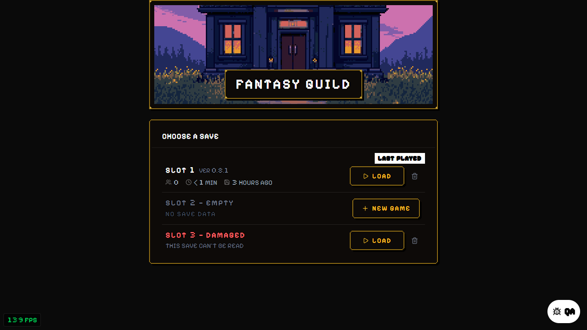
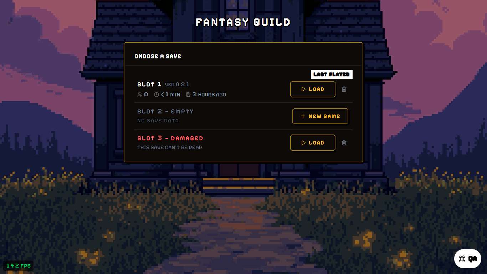
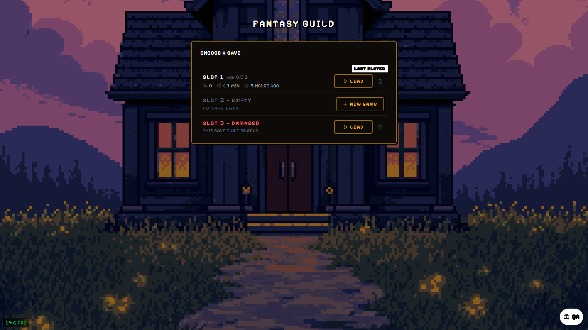
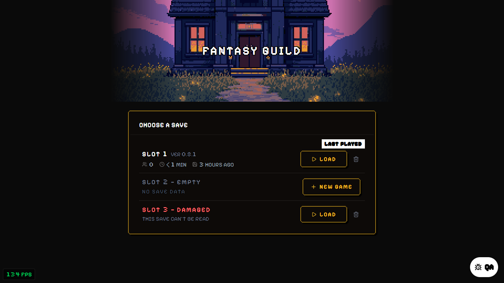
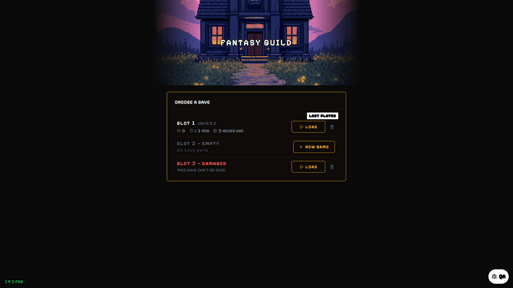
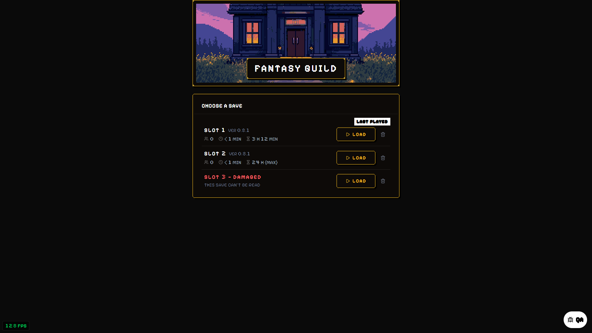
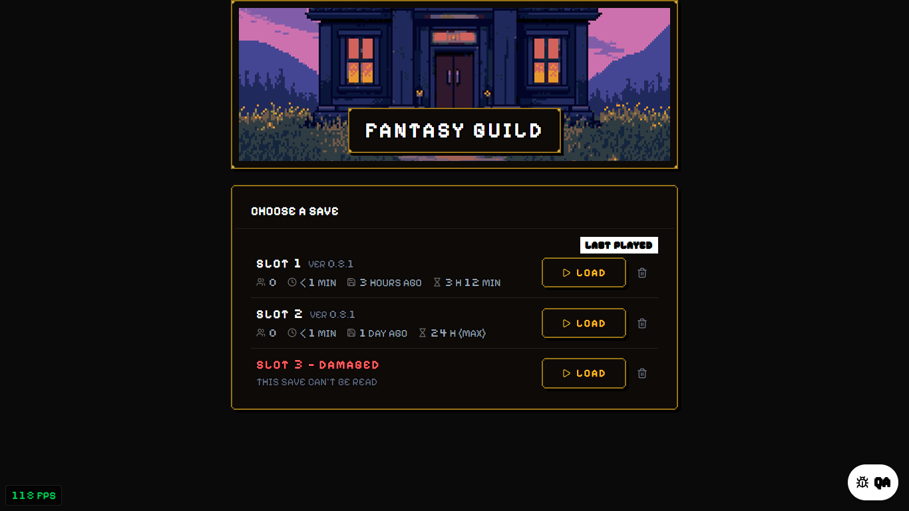

# Title screen and settings: screenshots (brief 450 S1, S2; brief 440 A2)

Taken 2026-11-06 on `crunch/settings-title`, dev build, headless Chrome at 1366 x 768 and 1920 x 1080.
Slot 1 is a real save (a new game, its save time set 3 h 12 min back); slot 2 empty; slot 3 a save cut
off mid-write (damaged).

## Pick a title look

All three use the same stand-in picture, the Guild Hall area banner (`b_guild_hall`), and the game's
name in the display size. Picked in code (`TITLE_LOOK` in `src/ui/components/title/titleArt.js`), not in
the game. **Built default: framed.**

| Look | 1366 | 1920 |
|---|---|---|
| **A. Framed** (default): the picture in a studs frame the slots' width, the name on a plate at its foot |  |  |
| **B. Backdrop**: the picture fills the screen (6x at 1366, 8x at 1920), the slots over it |  |  |
| **C. Strip**: the picture as a band across the top at 3x, fading at its sides, the name over it |  |  |

Recommendation: **A, framed**. It reads the same at both widths, the name stays legible on its plate
whatever picture is behind it, and it keeps "the slots beneath". B is the most title-screen-like and
suits a full painting, but a 256 px banner at 8x is very coarse; C leaves the sides of a wide screen
empty.

**Swapping in the owner's art**: drop `public/assets/ui/u_title_logo.png` (the logo, replaces the
written name) and `public/assets/backgrounds/title/b_title_painting.png` (the painting, replaces the
banner). No code change; both draw at whole multiples, pixelated.

## Time away on the slots (440 A2): keep or replace "Last saved"

| | 1366 | 1920 |
|---|---|---|
| **Replaced** (built): the hourglass time away instead of the last save, whose time moves to its tooltip |  |  |
| **Kept**: both, last save then time away |  |  |

Slot 2 here was saved 30 h ago: it reads `24 h (max)`, what a load plays. Recommendation: **replaced**;
the two stats say the same span twice, and the tooltip still gives "last saved 3 hours ago".
(`AWAY_REPLACES_LAST_SAVED` in `SlotSelectionModal.jsx`.)

## Load, delete and the slot messages

- `game_delete_confirm_*`: the delete confirm on the damaged slot (Cancel kept it).
- `game_deleted_*`: confirmed: the slot is empty and the message reads "Slot 3 deleted".
- `game_damaged_load_*`: Load on a damaged slot: the existing message, "Load Failed - Save Corrupted", and the title stays.
- `game_loaded_*`: Load on slot 1: the catch-up plays its 3 h and the game opens.

## Settings, opened on an old settings file

The stored file held the five retired keys, a 1-minute auto-save, DotGothic, all caps off, menu on the
right, the Forest background, flying items and item stubs off: every choice loaded as stored (the
master volume reads 0 from the existing one-time dev mute, as before). The retired keys were gone from
the file after the next save.

- `game_settings_display_*`, `game_settings_game_*`, `game_settings_audio_*`, `game_settings_dev_*`.
